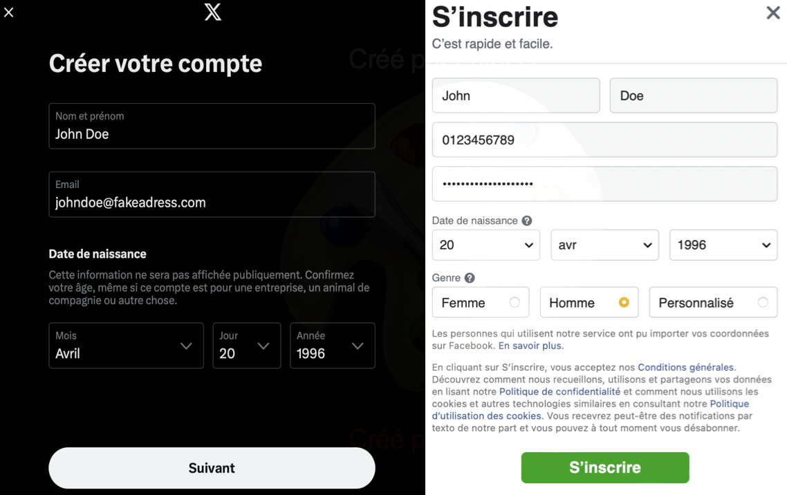
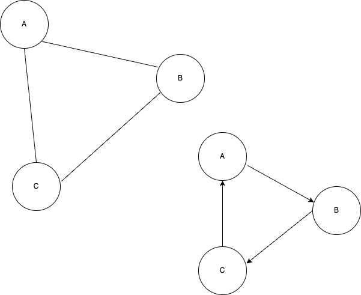

# Les réseaux sociaux

Un réseau social numérique ne se confond ni avec Internet ni avec le Web en général. C'est une plateforme précise, sur laquelle chaque utilisateur a un profil, des relations et un fil de contenus. Ce cours commence par définir les réseaux sociaux, puis explique comment ils gagnent de l'argent et comment ils choisissent les contenus qu'ils montrent. Il montre enfin comment représenter un réseau social par un graphe.

> **Définition**
> Un **réseau social numérique** est une plateforme en ligne qui permet de créer un profil, de se relier à d'autres personnes et de partager du contenu, comme des textes, des images ou des vidéos.

**Activité : analyse comparative**

**Choisir un réseau social et analyser :**
- **Fondateur(s) et date de création**
- **Spécificité principale** (texte, image, vidéo...)
- **Public cible et nombre d'utilisateurs**
- **Modèle économique**

## Des formats différents

Les réseaux sociaux ne proposent pas tous le même format, et ce format limite déjà ce qu'on peut y dire.

| Type de contenu | Caractéristiques | Réseaux spécialisés | Ce que cela produit |
|-----------------|------------------|---------------------|--------|
| **Texte court** | Messages limités (280 caractères) | Twitter, Threads | Information rapide, débats |
| **Images** | Photos, illustrations, mèmes | Instagram, Pinterest | Expression visuelle |
| **Vidéos courtes** | 15 s à 3 min, souvent verticales | TikTok, YouTube Shorts, Reels | Divertissement, circulation très rapide |
| **Vidéos longues** | Cours, spectacles, directs | YouTube, Twitch | Apprentissage, communautés |
| **Audio** | Podcasts, discussions | Clubhouse, Spaces, Discord | Conversations plus longues |
| **Professionnel** | Parcours, articles | LinkedIn | Travail, mise en relation |

Le choix d'un réseau ne dépend donc pas seulement des goûts de chacun : une idée qui tient en une image ne se partage pas au même endroit qu'un cours d'une heure.

## Histoire et modèle économique

Les réseaux sociaux grand public apparaissent au début des années 2000, quand les ordinateurs entrent dans les foyers. Plusieurs d'entre eux étaient alors très différents de ce qu'ils sont aujourd'hui. Facebook, au départ, ne reliait que les étudiants de Harvard.

Ces plateformes coûtent cher, car il faut payer les serveurs, les salaires et la modération. Beaucoup sont pourtant gratuites à l'inscription, alors que les sociétés qui les gèrent cherchent à faire des bénéfices. Quand un service ne fait pas payer ses utilisateurs, c'est en général leur attention, et les données qui la décrivent, qui sont vendues aux annonceurs.

Les contenus, eux, viennent des utilisateurs. Une personne partage ce qui l'intéresse, un commerce cherche des clients, une marque paie un créateur pour montrer un produit. Chacun reste pénalement responsable de ce qu'il publie, car un message publié est considéré comme public. Publier un propos discriminatoire, une diffamation ou du harcèlement constitue une infraction, même sur un réseau social.

Toutes ces publications laissent une trace. On appelle **e-réputation** l'image qu'une personne donne d'elle en ligne, par ses textes, ses photos, ses prises de position ou ses placements de produit. Elle ne se limite pas à ce que la personne voulait montrer : elle comprend aussi tout ce que les autres peuvent encore trouver à son sujet.

## Les algorithmes de recommandation

Le fil d'actualité n'est pas la liste chronologique de ce que les contacts ont publié. Un algorithme de recommandation choisit les contenus et décide de leur ordre. Il s'appuie sur les mentions « j'aime », les partages et le temps passé devant chaque vidéo. Son objectif principal est de garder l'utilisateur le plus longtemps possible dans l'application, plutôt que de l'informer au mieux.

Quand l'utilisateur s'arrête sur le football, le fil se remplit de football. S'il lit surtout un bord politique, le fil lui renvoie des gens déjà d'accord avec lui. On appelle cela une **bulle de filtres**, ou une chambre d'écho. À force, on finit par croire que tout le monde pense comme soi, simplement parce que les avis contraires n'arrivent plus jusqu'à l'écran.

<FilterBubble />

Pour en sortir un peu, il faut aller chercher soi-même des comptes très différents des siens, car l'algorithme ne les proposera pas.

## L'âge et le profil

> **Définition**
> La **majorité numérique** est l'âge à partir duquel un mineur peut consentir seul au traitement de ses données personnelles sur une plateforme.

En France, ce seuil est à 15 ans. Avant, l'inscription suppose l'accord d'un parent, et un contrôle parental reste utile. Entre 15 et 18 ans, l'inscription est possible sans accord parental, mais il reste utile de demander de l'aide en cas de problème. À partir de 18 ans, la responsabilité est entière. Cette règle ne fait pas disparaître les risques, qui existent à 14 ans comme à 30.

La création d'un compte suit presque toujours les mêmes étapes, et chacune peut amener à en dire trop. Il faut d'abord donner un e-mail ou un numéro de téléphone, puis un mot de passe. Utiliser une adresse réservée à ces inscriptions limite les dégâts en cas de fuite. Viennent ensuite le nom affiché et la photo, qui doivent en révéler le moins possible sur la vie réelle. La biographie et les centres d'intérêt peuvent rester vagues. Il vaut mieux régler les paramètres de visibilité avant d'ajouter des contacts, en choisissant un profil privé. Enfin, une demande de contact ne prouve pas que la personne est bien celle qu'elle prétend être.

## Les cyberviolences

Le harcèlement ne s'arrête pas à la porte du lycée : il peut continuer en ligne.

| Type | De quoi il s'agit | Exemples | Conséquences |
|------|-------------|----------|-------------|
| **Cyberharcèlement** | Attaques répétées | Insultes, moqueries publiques | Anxiété, isolement |
| **Doxxing** | Publication d'informations privées | Adresse, téléphone, photos intimes | Chantage, atteinte à la vie privée |
| **Revenge porn** | Diffusion d'images sans consentement | Photos ou vidéos intimes | Humiliation, détresse |
| **Cyberstalking** | Surveillance | Géolocalisation, espionnage de comptes | Sentiment d'être suivi |
| **Discours de haine** | Propos qui visent un groupe | Insultes racistes, homophobes | Discrimination |

Plusieurs services peuvent aider les victimes de ces violences, ainsi que leurs témoins.

| Service | Contact | Spécialité |
|---------|---------|------------|
| **3018** | Numéro gratuit | Violences numériques, pour les mineurs |
| **3919** | Numéro national | Violences faites aux femmes |
| **Net Écoute** | 0800 200 000 | Accompagnement des jeunes |
| **Pharos** | pharos.gouv.fr | Signalement de contenus illicites |

Un mineur victime de violence en ligne peut appeler le 3018. Pharos permet de signaler un contenu illicite, mais il ne remplace pas une discussion avec un adulte de confiance.

## Représenter un réseau par un graphe

> **Définition**
> Un **graphe** est une structure mathématique qui représente des relations entre des entités. Sur un réseau social, les entités sont les comptes, et les relations sont les liens entre eux.

Un **sommet** représente un compte. Une **arête** représente une relation, comme une amitié, un abonnement ou une mention. Quand la relation a une intensité, par exemple la fréquence des échanges, on lui attribue un **poids**. Quand elle a un sens, par exemple quand une personne en suit une autre sans être suivie en retour, le graphe est **orienté**. Une amitié réciproque se dessine au contraire sans flèche.

Quelques mesures permettent de décrire la forme d'un réseau.

La **distance** entre deux sommets est le plus petit nombre d'arêtes qui les séparent. L'**écartement** d'un sommet est la plus grande de ces distances, entre lui et les autres. Le **centre** est le sommet dont l'écartement est le plus petit. C'est la personne la mieux placée pour joindre tout le monde en peu d'étapes. Le **rayon** est l'écartement du centre. Le **diamètre** est la plus grande distance entre deux sommets quelconques, et il donne une idée de la « largeur » du réseau.

<GraphMetricsExplorer />

**Indiquer sur le dessin ci-dessous quel graphe est orienté et lequel est non orienté.**

**Un groupe compte 6 amis : Alice, Bob, Charlie, David, Emma et Frank. Modéliser leurs amitiés à l'aide d'un graphe. Un graphe est constitué de sommets (les personnes) et d'arêtes (les relations d'amitié). Voici les informations sur leurs amitiés :**

- Alice est amie avec Bob, Charlie et Emma.
- Bob est ami avec Alice, David et Frank.
- Charlie est ami avec Alice et Emma.
- David est ami avec Bob et Frank.
- Emma est amie avec Alice et Charlie.
- Frank est ami avec Bob et David.

**Activité**

* À l'aide du graphe de l'exercice précédent, calculer les écartements de chaque sommet.
* En déduire le **centre** du graphe.
* Donner le **rayon** de ce graphe.
* En déduire le **diamètre** de ce graphe.

## L'expérience de Milgram

En 1967, le psychologue Stanley Milgram veut mesurer à quel point deux inconnus sont proches. Il demande à des volontaires du Midwest d'envoyer une lettre à un agent de change de Boston. Chaque personne ne peut transmettre la lettre qu'à une connaissance personnelle, choisie parce qu'elle a des chances de la rapprocher du destinataire.

Les lettres qui arrivent passent en moyenne par cinq ou six intermédiaires. De là vient l'idée des **six degrés de séparation** : deux personnes sur Terre seraient reliées par une chaîne d'environ six relations.

<SocialGraph />

Avec les réseaux sociaux comme Facebook, Twitter ou LinkedIn, ces chaînes se sont raccourcies : des études internes de Facebook ont estimé cette distance à environ 3,5.
