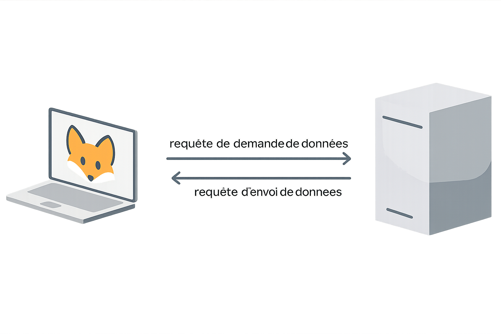

# Web

Internet est un réseau, et le Web est une application qui fonctionne sur ce réseau. Il est fait de pages, de liens et d'images, que le navigateur va chercher sur des serveurs. Ce cours retrace la naissance du Web, puis explique ce qui se passe vraiment quand une adresse est tapée.

## La naissance du Web

En 1989, Tim Berners-Lee et Robert Cailliau travaillent au CERN, en Suisse. Leur problème est concret : les chercheurs ont des documents éparpillés sur des machines différentes, et personne ne sait plus où chercher. Ils proposent de relier ces documents par des **hyperliens**, des liens cliquables qui mènent d'une ressource à une autre, même si elle est stockée ailleurs dans le monde.

En 1991, la première page est mise en ligne au CERN. Elle présente le projet et explique comment s'en servir. En 1993, le CERN décide que le Web sera libre, sans redevance. Cette décision est aussi importante que l'invention elle-même, car n'importe qui peut alors publier sans payer de licence aux inventeurs. C'est ce qui permet au Web de se développer très rapidement. Aujourd'hui, on compte plus de 1,7 milliard de sites.

Au début, le Web sert surtout à lire. Entre 1990 et 2000 environ, une page ressemble à un journal, que l'on consulte sans pouvoir y participer. On parle parfois de Web 1.0. À partir des années 2000, chacun peut aussi publier un commentaire, une photo ou un article de wiki. C'est le Web participatif, souvent appelé Web 2.0. Les réseaux sociaux, les blogs et les wikis en sont les formes les plus visibles.

Dans les années 1990, deux navigateurs se disputent le marché, Netscape et Internet Explorer. Microsoft remporte cette première bataille, avant que Chrome ne prenne sa place quelques années plus tard. Le navigateur n'est pas le Web lui-même, c'est le programme qui permet de l'afficher. Cependant, le navigateur qui domine le marché influence beaucoup ce que les sites peuvent faire.

> Un hyperlien est un lien cliquable vers une ressource, parfois sur un autre serveur. C'est l'idée centrale du Web, puisqu'un document peut ainsi renvoyer à d'autres documents.

Voici un lien vers l'accueil du site : [accueil](../../index.md). Pour voir à quoi ressemblait le tout début, la [première page du CERN](http://info.cern.ch/hypertext/WWW/TheProject.html) est encore en ligne.

## Le modèle client-serveur

Le Web fonctionne en **client-serveur**. Les deux machines n'ont pas le même rôle, et ce rôle peut changer d'une requête à l'autre.

Le **client** est la machine qui veut recevoir quelque chose. Dans la vie courante, c'est le navigateur. Du point de vue de TCP, c'est la machine réceptrice. Le **serveur** détient la page, l'image ou la vidéo, et l'envoie : c'est la machine émettrice.

Le client et le serveur échangent des **requêtes**, c'est-à-dire des messages dont la forme est fixée à l'avance. Une requête peut demander une ressource ou en envoyer une, et la machine qui la reçoit sait comment la lire.



## Les URL et le DNS

Pour ouvrir Google, personne ne tape `216.58.214.163`. On utilise plutôt une **URL** (*Uniform Resource Locator*), une adresse faite pour être lue par des humains.

<UrlBuilder />

Le **DNS** (*Domain Name System*) tient la table de correspondance entre ces noms et les adresses IP. Chaque fois qu'un nom est demandé, il faut le traduire en adresse IP.

| Site | Adresse symbolique | Adresse IP |
|------|-------------------|------------|
| Google | www.google.fr | 172.217.20.163 |
| YouTube | www.youtube.fr | 142.250.178.142 |
| Leboncoin | www.leboncoin.fr | 18.164.52.43 |
| Amazon | www.amazon.fr | 52.95.116.113 |

Deux cas se présentent. Si le navigateur a déjà traduit ce nom récemment, il garde la réponse dans son **cache** et n'interroge personne. Chercher `www.google.fr` peut alors se résumer à réutiliser `172.217.20.163`. Si le nom est inconnu, la recherche part de serveur en serveur, jusqu'à celui qui connaît la réponse. On parle de résolution récursive.

<DnsResolver />

## Le langage HTML

> **HTML** (*HyperText Markup Language*) a été créé en 1991 par Tim Berners-Lee, au CERN. C'est un langage à **balises** : il décrit la structure d'une page, pas son apparence finale.

Une balise est un mot entouré de chevrons, `<` et `>`. La plupart s'ouvrent et se ferment. Le navigateur les lit sans les afficher : on voit le paragraphe, mais pas la balise `<p>`.

```html
<p>Ceci est un paragraphe.</p>

<h1>Titre principal</h1>
<h2>Sous-titre</h2>

<a href="https://example.com">Lien hypertexte</a>


```

Le HTML indique le rôle de chaque partie du contenu. Une balise de titre signale un titre, et pas simplement du texte écrit en gros. De même, un lien est une adresse vers une autre ressource, et pas seulement une phrase soulignée. La mise en forme est ajoutée ensuite, le plus souvent avec un autre langage, le CSS.

## Le protocole HTTP

> **HTTP** (*HyperText Transfer Protocol*) est le protocole qui fait circuler les pages sur le Web. Le client envoie une requête, et le serveur répond avec la ressource demandée, accompagnée d'un code qui indique si tout s'est bien passé.

Deux méthodes reviennent tout le temps. **GET** demande une ressource sans rien modifier sur le serveur, par exemple pour ouvrir une page ou charger une image. **POST** envoie des données, par exemple le contenu d'un formulaire.

<HttpMethodVisualizer />

Le serveur ne répond pas seulement par la page. Il ajoute un **code de statut**. `200` veut dire que la requête a réussi. `404` veut dire que la ressource n'existe pas, la fameuse page introuvable. `500` veut dire que le serveur lui-même a un problème, indépendamment de la demande.

## Pourquoi Google classe les pages comme il le fait

En 1996, Larry Page et Sergey Brin, à Stanford, proposent **PageRank**. Avant eux, un moteur cherchait surtout les mots de la page. Ils proposent de prendre aussi en compte l'importance de la page dans le réseau des liens.

Le principe ressemble à un vote. Quand une page pose un lien vers une autre, elle vote pour elle. Plus une page reçoit de liens, plus elle semble utile. Cependant, tous les votes n'ont pas le même poids. Un lien depuis une page déjà très citée compte plus que dix liens depuis des pages que personne ne regarde. C'est un peu comme au jeu du Loup-Garou, où le vote du maire compte double.

Ce calcul a aidé Google à proposer des résultats plus pertinents que ses concurrents de l'époque. Les moteurs d'aujourd'hui ont beaucoup ajouté par-dessus, mais l'idée de départ est restée : une page est importante en partie parce que d'autres pages renvoient vers elle.

<PageRankVisualizer />

## Les cookies

> **Définition : cookie**
> Un **cookie** est un petit fichier texte déposé sur l'ordinateur par un site visité. Il permet de garder une information d'une page à l'autre, comme le contenu d'un panier, une connexion ou une préférence de langue.

Tous les cookies ne servent pas le site consulté. Certains, déposés par des tiers, suivent l'internaute de site en site pour construire un profil publicitaire. C'est pour cela qu'une paire de chaussures poursuit l'internaute après une visite sur un site de sport.

<CookieManager />

## Le protocole HTTPS

En HTTP, les données circulent en clair. Quelqu'un placé sur le chemin, sur le même Wi-Fi par exemple, peut les lire. **HTTPS** ajoute un chiffrement (le S signifie *secure*), si bien que seuls le client et le serveur peuvent lire le contenu.

Le simulateur ci-dessous montre ce qu'un intermédiaire peut voir selon que le cadenas est là ou non. On appelle ce genre d'écoute une attaque de l'homme du milieu.

<HttpsSimulator />

Tant que le cadenas n'apparaît pas dans la barre d'adresse, il ne faut saisir ni mot de passe ni numéro de carte.
