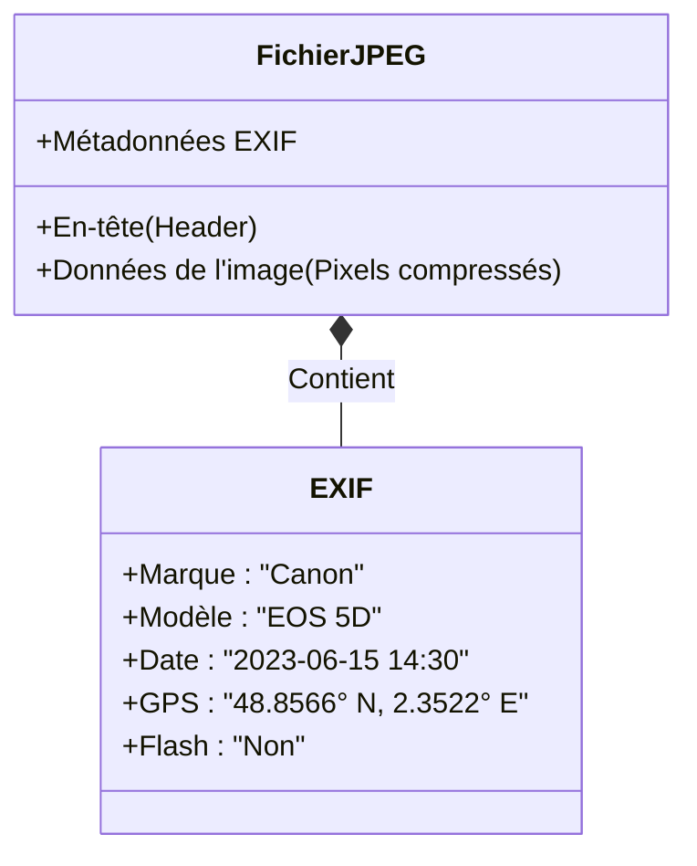

# Photographie couleur

Un écran ne peint pas. Il allume de toutes petites lumières, et c'est l'œil qui en fait une couleur. Pour comprendre le codage, il faut donc commencer par la rétine, pas par le fichier.

## Ce que l'œil fait déjà

Deux familles de cellules, sur la rétine, reçoivent la lumière.

Les **bâtonnets** sont très sensibles. Ils permettent de voir quand il fait sombre, mais ils ne distinguent pas les couleurs : la nuit, le monde passe en gris. Les **cônes** demandent plus de lumière. Il en existe trois sortes, sensibles surtout au rouge, au vert et au bleu. Toute la couleur perçue est une combinaison de ces trois réponses.

L'appareil photo numérique reprend la même idée : une optique qui concentre la lumière, un diaphragme qui en dose la quantité, une mise au point, puis une surface qui enregistre. Le capteur joue le rôle de la rétine.

| Composant | Fonction | Équivalent photo |
|-----------|----------|------------------|
| **Cornée** | Fait converger les rayons | Lentille frontale |
| **Iris** | Dose la lumière | Diaphragme |
| **Cristallin** | Fait la mise au point | Système de focus |
| **Rétine** | Reçoit l'image | Capteur CCD ou CMOS |

## Additionner des lumières

Un écran, qu'il soit d'ordinateur, de téléphone ou de télévision, fabrique les couleurs par **synthèse additive**. Il superpose trois lumières, rouge, vert et bleu. On parle de RVB, ou de RGB en anglais.

Rouge et vert donnent du jaune. Rouge et bleu donnent du magenta. Vert et bleu donnent du cyan. Les trois ensemble donnent du blanc, parce qu'on additionne toute la lumière. S'il n'y a aucune lumière, il reste le noir : l'écran n'émet rien.

Ce n'est pas la logique de la peinture. En peinture, mélanger des pigments retire de la lumière, on parle de synthèse soustractive. Ici, on en ajoute. C'est pour cela qu'un écran éteint est noir, et qu'un projecteur sans filtre est blanc.

## Comment on code un pixel

Chaque pixel couleur est fait de trois composantes. L'intensité de chacune est en général codée sur un octet, donc 8 bits, ce qui donne un entier entre 0 et 255. Une composante qui vaut 0 est éteinte, et une composante qui vaut 255 est au maximum.

Avec trois octets, chaque pixel occupe donc 24 bits. On note la couleur `(R, V, B)`. Le vert s'écrit parfois G, pour *green*, dans les logiciels en anglais : c'est la même composante.

Quelques couleurs tombent juste, parce qu'elles allument une composante à fond et éteignent les autres. Le gris moyen allume les trois à mi-chemin. L'écriture hexadécimale compacte chaque octet sur deux caractères : 255 s'écrit `FF`, 0 s'écrit `00`.

| Couleur | Code RVB (décimal) | Code hexadécimal |
|---------|-------------------|------------------|
| **Noir** | (0, 0, 0) | #000000 |
| **Blanc** | (255, 255, 255) | #FFFFFF |
| **Rouge** | (255, 0, 0) | #FF0000 |
| **Vert** | (0, 255, 0) | #00FF00 |
| **Bleu** | (0, 0, 255) | #0000FF |
| **Jaune** | (255, 255, 0) | #FFFF00 |
| **Magenta** | (255, 0, 255) | #FF00FF |
| **Cyan** | (0, 255, 255) | #00FFFF |
| **Gris moyen** | (128, 128, 128) | #808080 |

## Combien pèse l'image

Le poids dépend de deux choses : le nombre de pixels, et le nombre de bits par pixel.

$$ \text{Poids (bits)} = \text{Nombre de pixels} \times \text{Taille d'un pixel (bits)} $$

En couleur « classique », 24 bits, chaque pixel occupe 3 octets :

$$ \text{Poids (octets)} = \text{Nombre de pixels} \times 3 $$

Une image de 800 par 600 fait 480 000 pixels. En couleur, sans compression, cela donne $480\,000 \times 3 = 1\,440\,000$ octets, environ 1,44 Mo. Dès que le fichier est plus léger, c'est qu'un format a comprimé, et parfois jeté, une partie de l'information.

## Changer les couleurs, pixel par pixel

Un filtre ne « voit » pas la photo. Il applique un calcul à chaque triplet `(R, V, B)`. Pour passer en niveaux de gris, on remplace les trois composantes par leur moyenne :

$$ Gris = \frac{R + V + B}{3} $$

Le pixel devient alors `(Gris, Gris, Gris)`. L'œil le lit comme une nuance, parce que les trois lumières sont égales. Les filtres des applications photo sont des variantes de cette idée : une formule, répétée sur toute la grille.

<FilterPlayground />

## Compresser

Envoyer 1,44 Mo pour une petite photo serait pénible. On comprime.

Un fichier **RAW** ou **BMP** ne jette rien. La qualité est maximale, le fichier aussi. Le **PNG** comprime sans perte : on retrouve exactement les mêmes pixels, ce qui convient aux logos, aux schémas, aux aplats. Le **JPEG** comprime en acceptant de perdre des nuances que l'œil distingue mal. C'est le format des photos, pas celui d'un texte en toutes lettres sur un fond uni : là, les défauts se voient.

<ImageCompression />

## Les métadonnées voyagent avec l'image

Le fichier ne contient pas que les pixels comprimés. Un en-tête, et souvent un bloc **EXIF**, décrivent l'appareil, la date, les réglages, et parfois l'endroit.

La marque, l'heure et le flash sont déjà des informations. La position GPS en est une autre : elle peut dire où se trouvait le photographe au moment de la photo. Publier l'image sans retirer ces champs, c'est parfois publier une adresse. Le chapitre [Localisation](./Cours_Localisation.md) revient sur ce point.

## Le droit à l'image

En France, chacun décide de l'usage de sa propre image. Avant de publier la photo de quelqu'un, la question n'est pas seulement technique.

<ImageRights />

Publier la photo d'une personne sans son accord, dans un lieu privé, est un délit. L'article 226-1 du code pénal le punit d'un an d'emprisonnement et de 45 000 euros d'amende.
