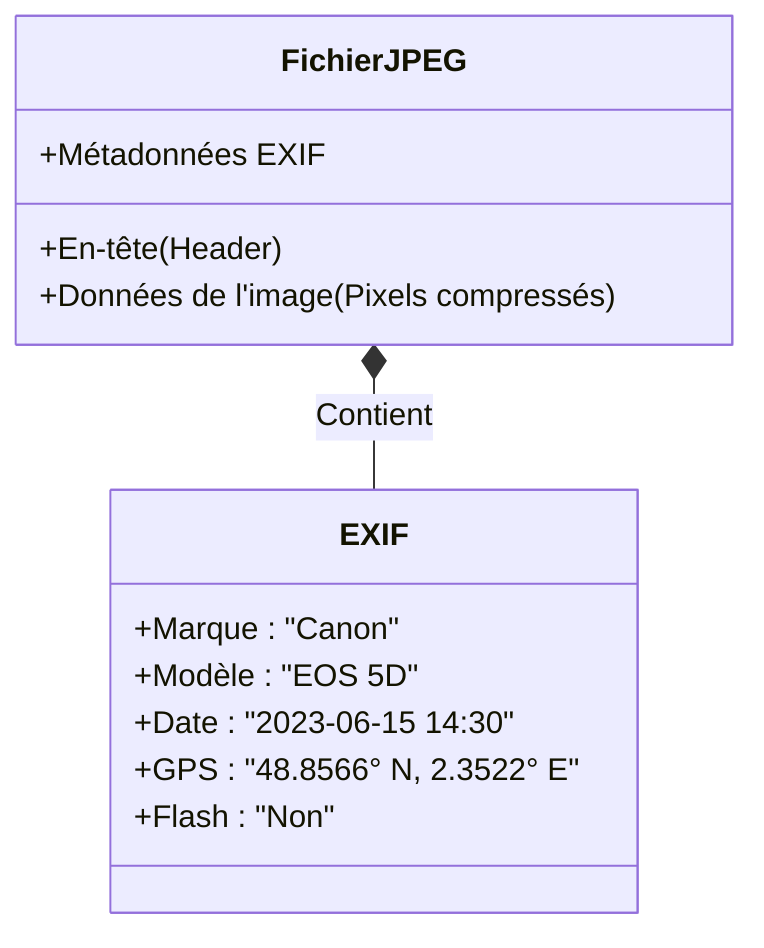

# Photographie couleur

Un écran ne mélange pas de la peinture : il allume de toutes petites lumières, et c'est l'œil qui les perçoit comme une couleur. Pour comprendre comment une couleur est codée, il faut donc d'abord comprendre comment fonctionne l'œil.

## La vision des couleurs

Sur la rétine, deux types de cellules reçoivent la lumière.

Les **bâtonnets** sont très sensibles. Ils permettent de voir quand il fait sombre, mais ils ne distinguent pas les couleurs : la nuit, le monde passe en gris. Les **cônes** demandent plus de lumière. Il en existe trois sortes, sensibles surtout au rouge, au vert et au bleu. Toutes les couleurs perçues sont des combinaisons de ces trois réponses.

L'appareil photo numérique reprend le même principe. Une optique concentre la lumière, un diaphragme en dose la quantité, un système de mise au point rend l'image nette, puis une surface enregistre l'image. Le capteur joue le rôle de la rétine.

| Composant | Fonction | Équivalent photo |
|-----------|----------|------------------|
| **Cornée** | Fait converger les rayons | Lentille frontale |
| **Iris** | Dose la lumière | Diaphragme |
| **Cristallin** | Fait la mise au point | Système de focus |
| **Rétine** | Reçoit l'image | Capteur CCD ou CMOS |

## La synthèse additive

Un écran, qu'il soit d'ordinateur, de téléphone ou de télévision, fabrique les couleurs par **synthèse additive**. Il superpose trois lumières : une rouge, une verte et une bleue. On parle de RVB, ou de RGB en anglais.

Rouge et vert donnent du jaune. Rouge et bleu donnent du magenta. Vert et bleu donnent du cyan. Les trois ensemble donnent du blanc, parce qu'on additionne toute la lumière. S'il n'y a aucune lumière, il reste le noir : l'écran n'émet rien.

La peinture fonctionne autrement : mélanger des pigments retire de la lumière, et l'on parle alors de synthèse soustractive. Un écran, au contraire, ajoute de la lumière. C'est pour cela qu'un écran éteint est noir, et qu'un projecteur sans filtre est blanc.

## Le codage d'un pixel

Chaque pixel couleur est fait de trois composantes. L'intensité de chacune est en général codée sur un octet, donc 8 bits, ce qui donne un entier entre 0 et 255. Une composante qui vaut 0 est éteinte, et une composante qui vaut 255 est au maximum.

Avec trois octets, chaque pixel occupe donc 24 bits. On note la couleur `(R, V, B)`. Le vert s'écrit parfois G, pour *green*, dans les logiciels en anglais : c'est la même composante.

Certaines couleurs s'obtiennent simplement, en allumant une ou deux composantes au maximum et en éteignant les autres. Le gris moyen allume les trois composantes à moitié. L'écriture hexadécimale permet de noter chaque octet avec seulement deux caractères : 255 s'écrit `FF` et 0 s'écrit `00`.

| Couleur | Code RVB (décimal) | Code hexadécimal |
|---------|-------------------|------------------|
| **Noir** | (0, 0, 0) | #000000 |
| **Blanc** | (255, 255, 255) | #FFFFFF |
| **Rouge** | (255, 0, 0) | #FF0000 |
| **Vert** | (0, 255, 0) | #00FF00 |
| **Bleu** | (0, 0, 255) | #0000FF |
| **Jaune** | (255, 255, 0) | #FFFF00 |
| **Magenta** | (255, 0, 255) | #FF00FF |
| **Cyan** | (0, 255, 255) | #00FFFF |
| **Gris moyen** | (128, 128, 128) | #808080 |

## Le poids d'une image

Le poids d'une image dépend du nombre de pixels et du nombre de bits utilisés pour chaque pixel.

$$ \text{Poids (bits)} = \text{Nombre de pixels} \times \text{Taille d'un pixel (bits)} $$

En couleur « classique », sur 24 bits, chaque pixel occupe 3 octets :

$$ \text{Poids (octets)} = \text{Nombre de pixels} \times 3 $$

Une image de 800 par 600 fait 480 000 pixels. En couleur, sans compression, cela donne $480\,000 \times 3 = 1\,440\,000$ octets, environ 1,44 Mo. Si le fichier est plus léger, c'est que son format a compressé une partie de l'information, et en a parfois supprimé.

## Appliquer un filtre

Un filtre ne « voit » pas la photo : il applique simplement un calcul à chaque triplet `(R, V, B)`. Pour passer en niveaux de gris, on remplace les trois composantes par leur moyenne :

$$ Gris = \frac{R + V + B}{3} $$

Le pixel devient alors `(Gris, Gris, Gris)`. L'œil le lit comme une nuance, parce que les trois lumières sont égales. Les filtres des applications photo reposent sur la même idée : une formule appliquée à chaque pixel de l'image.

<FilterPlayground />

## La compression

Envoyer 1,44 Mo pour une petite photo serait peu pratique, c'est pourquoi les images sont compressées.

Un fichier **RAW** ou **BMP** ne supprime rien : la qualité est maximale, mais le fichier est très lourd. Le **PNG** compresse sans perte et redonne exactement les mêmes pixels, ce qui convient aux logos, aux schémas et aux aplats de couleur. Le **JPEG** compresse en acceptant de perdre des nuances que l'œil distingue mal. Il convient aux photos, mais pas à un texte sur un fond uni, où ses défauts se voient.

<ImageCompression />

## Les métadonnées

Le fichier ne contient pas que les pixels compressés. Un en-tête, souvent accompagné d'un bloc **EXIF**, décrit l'appareil, la date, les réglages et parfois le lieu de la prise de vue.

La marque de l'appareil, l'heure et l'usage du flash sont déjà des informations sur la photo. La position GPS va plus loin, car elle indique où se trouvait le photographe au moment de la prise de vue. Publier une image sans retirer ces champs peut donc revenir à publier une adresse. Le chapitre [Localisation](./Cours_Localisation.md) revient sur ce point.

## Le droit à l'image

En France, chacun décide de l'usage de sa propre image. Avant de publier la photo de quelqu'un, il faut donc aussi se poser une question juridique.

<ImageRights />

Publier la photo d'une personne sans son accord, dans un lieu privé, est un délit. L'article 226-1 du code pénal le punit d'un an d'emprisonnement et de 45 000 euros d'amende.
