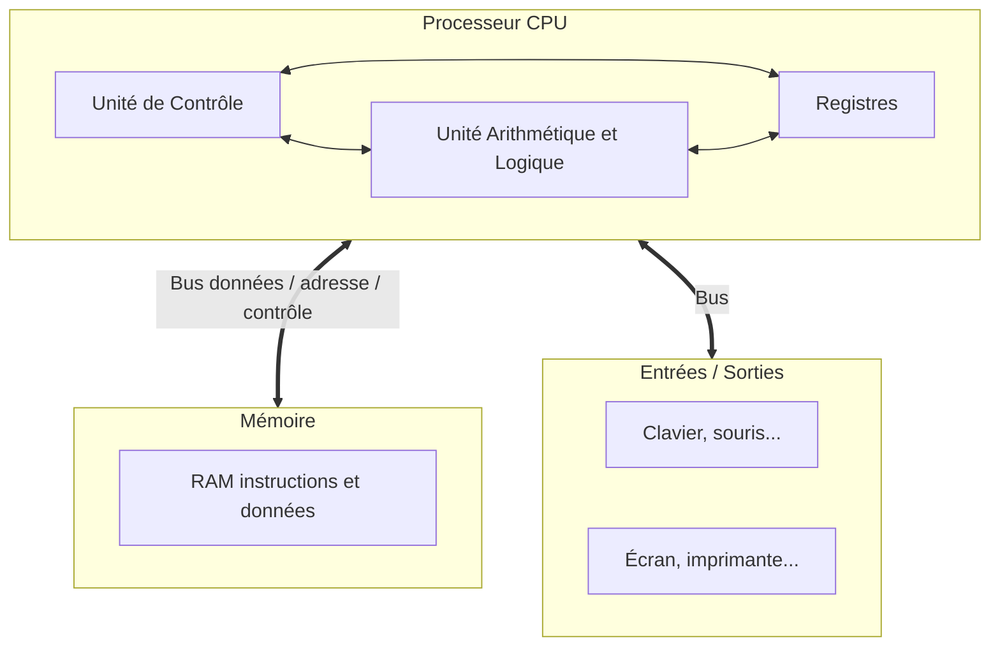

# Modèle de Von Neumann

Ouvrez un ordinateur, même en pensée : il y a un processeur, de la mémoire, des câbles, un clavier, un écran. Le modèle de von Neumann est la façon de nommer ces blocs, et surtout de dire dans quel ordre ils travaillent. Un ordinateur moderne exécute un programme **stocké en mémoire**, données et instructions au même endroit, **une instruction après l'autre**. C'est l'unité de contrôle qui mène ce défilé.

John von Neumann formalise cette architecture pour l'EDVAC, à la fin des années 1940. Deux idées tiennent tout : on calcule en binaire, et le programme n'est plus câblé dans la machine, il est écrit dans la mémoire, comme les données. On peut donc changer de programme sans ressouder.

## Dans le processeur

Le processeur réunit deux unités qu'il ne faut pas échanger. L'**unité arithmétique et logique**, l'UAL, fait les opérations : additions, comparaisons, décalages, opérations logiques. Elle s'appuie sur des **registres**, une toute petite mémoire interne, beaucoup plus rapide que la RAM, où elle pose les valeurs en cours de calcul.

L'**unité de contrôle**, l'UC, ne calcule pas le résultat. Elle décide quoi faire maintenant. Son cycle tient en quatre temps. Elle **lit** l'instruction en mémoire (*fetch*), elle la **décode** pour savoir quel opcode et quels opérandes elle contient (*decode*), elle **fait calculer** l'UAL (*execute*), puis elle **range** le résultat dans un registre ou en mémoire (*store*). L'horloge cadence ce cycle. Quand on vous dit qu'un processeur tourne à plusieurs gigahertz, on vous dit combien de ces battements il enchaîne par seconde, pas combien de travail utile il abat.

## Plusieurs mémoires, pas une

| Type | Rôle |
|---|---|
| **Cache** | Tout près du processeur, il accélère les accès répétés |
| **RAM** | Volatile : programmes et données en cours, perdus hors tension |
| **ROM** | Non volatile : ce qu'il faut pour démarrer (firmware, BIOS) |
| **Stockage** | Disque, SSD, clé USB : le long terme |

Dans le modèle, instructions et données cohabitent en RAM. C'est le **programme enregistré**. On peut donc, en théorie, traiter une instruction comme une donnée. C'est aussi ce qui permet à un programme d'en écrire un autre.

Le processeur ne va pas chercher une valeur « quelque part ». Il passe par des **bus**. Le bus de données transporte les valeurs. Le bus d'adresses dit où lire ou écrire. Le bus de contrôle porte les signaux : lecture, écriture, et le reste. Autour, les périphériques entrent des informations (clavier, souris), en sortent (écran, imprimante), ou font les deux (écran tactile, disque).

## Le tuyau le plus étroit

Le processeur, la mémoire et les bus n'avancent pas au même rythme. Le plus lent bride tous les autres. On appelle cela le **goulot d'étranglement**, le *bottleneck* : comme un tuyau trop fin au milieu d'une canalisation, il impose son débit à l'ensemble. Un processeur très rapide devant une mémoire lente passe son temps à attendre la prochaine instruction. Ajouter des gigahertz ne sert alors à rien.

Les quatre blocs à retenir sont le processeur (UC et UAL), la mémoire, les bus, et les entrées-sorties. Le cycle de l'UC est fetch, decode, execute, store. La RAM s'efface sans courant. La ROM et le stockage, non.

## Pour s'entraîner

Poursuivre avec [Circuits électroniques](/cours/2/archi_circuits) puis les [exercices sur les circuits](/cours/2/archi_circuits_exercices).
